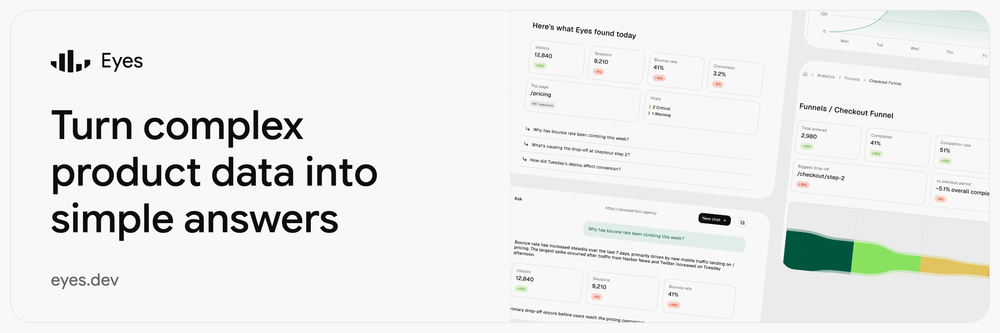

<a href="https://eyes.dev/?utm_source=github&utm_medium=referral&utm_campaign=org_profile&utm_content=banner">
  
</a>

# Eyes

Eyes is a powerful, privacy-friendly web and product analytics suite. Ask what's happening on your site in plain language, and its AI assistant answers from your own data, with charts and funnels to back it up.

Tracking is cookieless by default. Eyes counts visitors with site-specific IDs that rotate daily, keeps raw IP addresses out of analytics records and logs, and processes analytics and AI requests in the EU.

## Your data, explained

### [Ask about your product](https://eyes.dev/product?utm_source=github&utm_medium=referral&utm_campaign=org_profile&utm_content=product)

Ask where traffic came from, how a page converts, or what changed this week. Eyes queries your analytics and uses the results to answer, so you can follow up without building a report first.

### Charts, funnels, and retention

See traffic, sources, engagement, and Core Web Vitals alongside your custom events. Follow a journey through a funnel to find where people leave, or compare retention across cohorts to see who comes back.

### Watches and weekly digests

Watch a metric, conversion, funnel, or page performance, and Eyes alerts you when it changes. A weekly digest brings the week's changes together so you can catch up without checking every chart.

## Privacy

### Cookieless by default

Eyes counts visitors with a keyed hash of their IP address and browser type, scoped to your site and rotated daily. It stores pageviews, events, device details, and approximate location, but never writes raw IP addresses to your analytics or our logs. Raw IPs pass through processing and are deleted from the processing queue once the event is handled.

### EU storage and processing

Analytics data is stored in Frankfurt, Germany, and AI features process data in the EU. Consent mode can add a first-party cookie after a visitor agrees, so you can recognise them across visits. Read [how Eyes handles visitor data](https://eyes.dev/privacy?utm_source=github&utm_medium=referral&utm_campaign=org_profile&utm_content=privacy) for the details.

## Get started

Create a site in [Eyes](https://eyes.dev/?utm_source=github&utm_medium=referral&utm_campaign=org_profile&utm_content=get_started), then choose the script or an SDK. Replace `123456789` in these examples with your site's tracking ID.

### Browser script

Add the script to your site's `<head>`. It tracks pageviews and navigation automatically, with no package to install.

```html
<script src="https://cdn.eyes.dev/v1/eyes.js" data-site="123456789" defer></script>
```

[Script setup](https://eyes.dev/integrations/html?utm_source=github&utm_medium=referral&utm_campaign=org_profile&utm_content=script)

### [eyes-react](https://www.npmjs.com/package/eyes-react)

Wrap your app with `EyesProvider` to load the tracker and start tracking pageviews. Use `useEyes()` inside the provider to send custom events with `track()`.

```bash
pnpm add eyes-react
```

```tsx
import type { ReactNode } from 'react';
import { EyesProvider } from 'eyes-react';

export default function Analytics({ children }: { children: ReactNode }) {
  return <EyesProvider siteId="123456789">{children}</EyesProvider>;
}
```

[React setup](https://eyes.dev/integrations/react?utm_source=github&utm_medium=referral&utm_campaign=org_profile&utm_content=react)

### [eyes-next](https://www.npmjs.com/package/eyes-next)

Wrap your Next.js config with `withEyes` and add `EyesNextProvider` to your root layout. The SDK serves the tracker and forwards events through your own domain.

```bash
pnpm add eyes-next
```

```ts
// next.config.ts
import { withEyes } from 'eyes-next/config';

export default withEyes({});
```

```tsx
// app/layout.tsx
import type { ReactNode } from 'react';
import { EyesNextProvider } from 'eyes-next';

export default function RootLayout({ children }: { children: ReactNode }) {
  return (
    <html lang="en">
      <body>
        <EyesNextProvider siteId="123456789">{children}</EyesNextProvider>
      </body>
    </html>
  );
}
```

[Next.js setup](https://eyes.dev/integrations/nextjs?utm_source=github&utm_medium=referral&utm_campaign=org_profile&utm_content=nextjs)

## APIs and integrations

### [Events API](https://eyes.dev/integrations/events-api?utm_source=github&utm_medium=referral&utm_campaign=org_profile&utm_content=events_api)

Send signups, orders, and other backend events to `https://ingress.eyes.dev/v1/events`. Use an Events API key to send one event or a batch, including historical events with your own timestamps.

### [Analytics API](https://eyes.dev/integrations/analytics-api?utm_source=github&utm_medium=referral&utm_campaign=org_profile&utm_content=analytics_api)

Read traffic summaries, breakdowns, funnels, and retention from `https://api.eyes.dev/v1`. Each Analytics API key reads one site's aggregates, without exposing individual visitor or session records.

### [MCP server](https://eyes.dev/integrations/mcp?utm_source=github&utm_medium=referral&utm_campaign=org_profile&utm_content=mcp)

Connect your AI client to Eyes to query analytics where you already work. The MCP server provides tools for traffic, events, funnels, retention, and performance, with access through your Eyes account.

## Stack

[Next.js](https://nextjs.org) · [React](https://react.dev) · [TypeScript](https://www.typescriptlang.org) · [Laravel](https://laravel.com) · [Bun](https://bun.sh) · [PostgreSQL](https://www.postgresql.org) · [Redis](https://redis.io) · [ClickHouse](https://clickhouse.com) · [Cloudflare](https://www.cloudflare.com)

Built by [Pixel Perfect](https://github.com/pixel-perfect-agency).

## Contact

Have a question about Eyes or need help connecting your site? Visit [eyes.dev](https://eyes.dev/?utm_source=github&utm_medium=referral&utm_campaign=org_profile&utm_content=contact) or check [service status](https://status.eyes.dev/?utm_source=github&utm_medium=referral&utm_campaign=org_profile&utm_content=contact).
